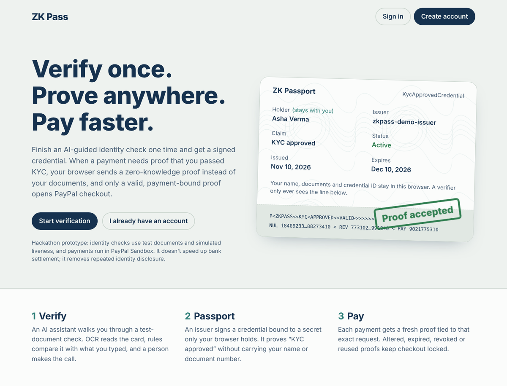
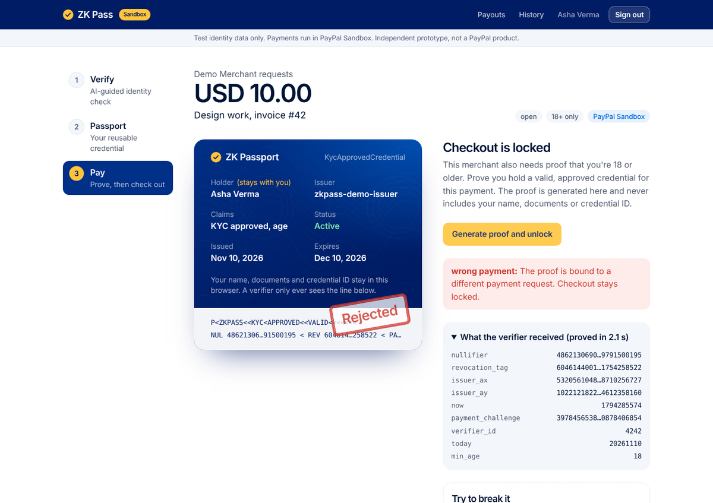
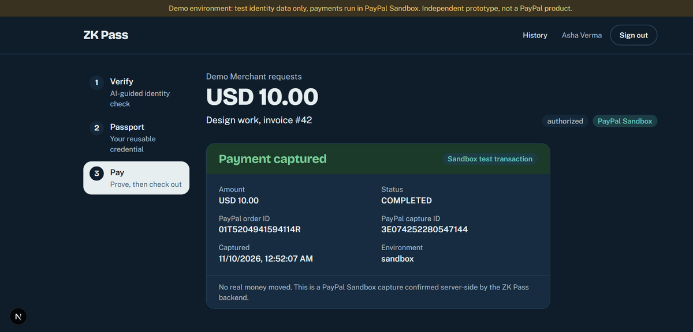
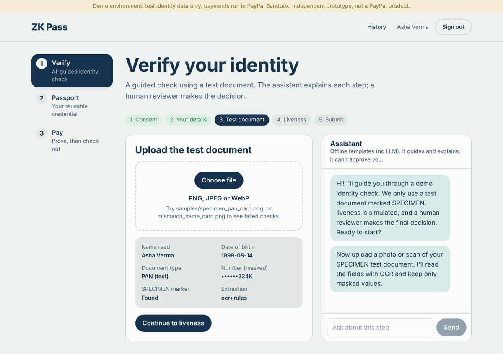
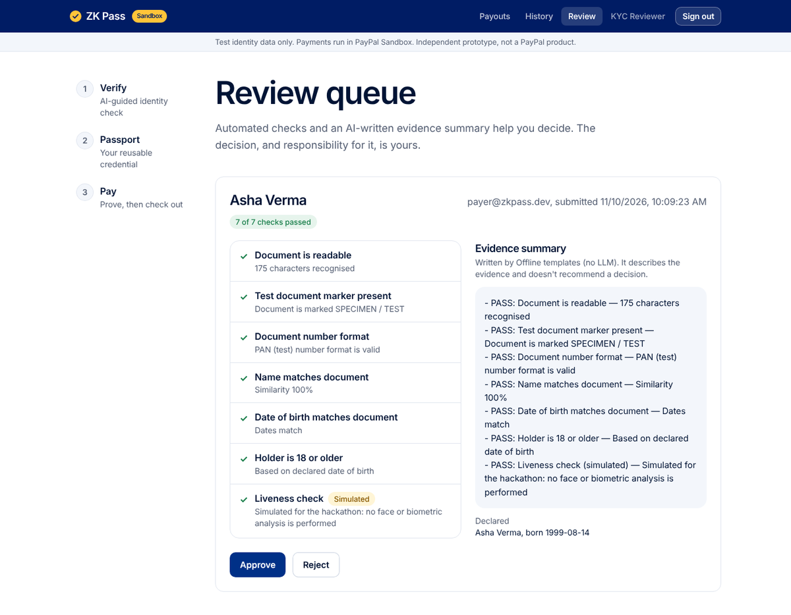
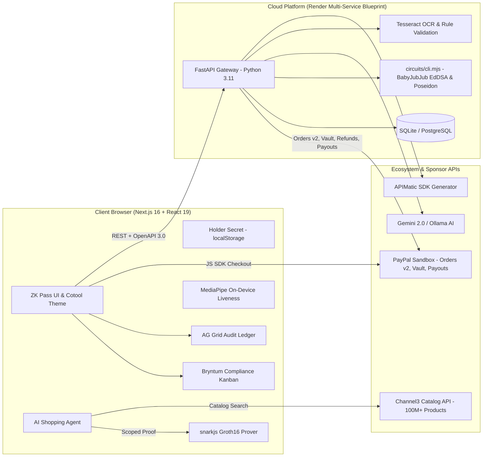

# ZK Pass

**Verify once. Prove anywhere. Pay faster.**

ZK Pass is a privacy-preserving identity verification and payment authorization
platform built for the [PayPal AI Hackathon](https://paypalaihackathon.devpost.com/).

A user completes an AI-assisted KYC check once and receives an issuer-signed credential
bound to a secret that only their browser holds. When a payment needs proof that they
passed KYC, the browser generates a real **Groth16 zero-knowledge proof** instead of
sharing documents. Only a valid, payment-bound proof unlocks **PayPal Sandbox** checkout,
and the backend captures and validates the order server-side.

> Independent hackathon prototype, not an official PayPal product.
> All identity data is mock/test data and all payments run in **PayPal Sandbox**. No real money moves.

**Demo video:** _link coming soon_



## What it does

| Module | What happens | Technology & Sponsor Integration |
|---|---|---|
| **ZK Verify AI** | An AI assistant guides a KYC session. Tesseract OCR reads a SPECIMEN test card, rule-based checks compare it with what the user typed, an **on-device liveness check** (MediaPipe: blink and head-turn prompts in random order) runs in the browser, and the AI writes a neutral evidence summary. A **human reviewer** approves or rejects. | **Gemini 2.0 / Ollama** + **MediaPipe** on-device WASM |
| **ZK Passport** | The browser creates a holder secret and sends only `Poseidon(secret)`. The issuer signs the credential (EdDSA on BabyJubJub over a Poseidon hash) with the `kyc_approved` claim, an expiry date and the date of birth. | **BabyJubJub** + **Poseidon** cryptographic commitments |
| **ZK Pay** | For each payment, the browser proves in-circuit: valid issuer signature, holder binding, `kyc_approved = 1`, not expired, and, when the merchant asks, **age ≥ 18 without revealing the birth date**. It outputs a one-time **nullifier** bound to that payment and a verifier-scoped **revocation tag**. | **Circom 2** + **snarkjs Groth16** (~2s browser proving) |
| **Agentic Commerce** | Autonomous AI shopping agent queries real-time e-commerce inventory across 100M+ products. The buyer confirms a purchase and the agent checks out using a delegated ZK Pass proof without exposing customer name, address, or credit card details to merchants. | **Channel3 API** + **Agentic Commerce** (`/agent`, `/shop`) |
| **Audit Ledger & Reviewer Grid** | Compliance officers and financial auditors monitor high-throughput verification queues and cryptographic settlements with pinned columns, monospace public signal inspectors (nullifiers, revocation tags), and 1-click CSV/Excel export. | **AG Grid** (`@ag-grid-community/react`) (`/history`, `/review`) |
| **Compliance Workflow Board** | Visual drag-and-drop Kanban managing KYC lifecycles (*01 OCR Parsed* → *02 Liveness OK* → *03 AI Evidence Ready* → *04 Human Review* → *05 Passport Issued*). Reviewers drag cards to approve sessions and trigger issuer signatures. | **Bryntum TaskBoard** (`/review/board`) |
| **Merchant SDK Gateway** | Standardized OpenAPI 3.0 specification (`openapi.yaml`) with auto-generated client SDKs across TypeScript, Python, Go, and PHP. Web2 merchants can gate their checkout behind zero-knowledge verification in under 5 lines of code. | **APIMatic** CodeGen & Developer Portal (`/developers`) |
| **Cloud Infrastructure** | Production multi-service cloud architecture orchestrating the Python 3.11/Tesseract backend and the Next.js 16 Turbopack frontend with automated health check monitoring (`/api/health`). | **Render** Blueprint (`render.yaml`) |

The backend rejects proofs that are **altered**, **bound to another payment**, **stale**,
from an **untrusted issuer**, **revoked**, **replayed**, or missing the request's **age requirement**.
Checkout stays locked until a proof passes. The payment page has an interactive *Try to break it* security
test suite that demonstrates each case.

### What the proof unlocks in PayPal

| Feature | PayPal API | What the ZK proof gates |
|---|---|---|
| **Checkout** | Orders v2 create + capture, JS SDK | The buyer can't open checkout until a fresh, payment-bound proof passes. The backend validates the capture before marking it paid. |
| **18+ purchases** | Orders v2 | The merchant marks a request 18+; only a holder whose signed birth date proves they're old enough can unlock it. |
| **One-click repeat payments** | Orders v2 with PayPal **Vault** (`store_in_vault`, `vault_id`) | Save PayPal once, then pay later with no popup. A saved wallet never skips the proof: each payment still needs its own. |
| **Refunds** | Payments v2 capture refund | Only the merchant who was paid can refund; repeat refunds are idempotent. |
| **Payouts to verified people** | Payouts v1 | A platform pays a freelancer only after *the recipient* proves KYC with their Passport; each payout is claimed once. |

| A proof bound to another payment is rejected | A valid proof unlocks a real PayPal Sandbox capture |
|---|---|
|  |  |

| AI-guided document check | Human review with an AI evidence summary |
|---|---|
|  |  |

### The privacy property

The verifier receives nine public values: the nullifier, revocation tag, issuer public key,
timestamp, payment challenge, verifier ID, today's date and the required minimum age. It never
sees the user's name, date of birth, document number, credential ID or holder secret. Raw
document images are processed in memory and discarded; only masked fields and check outcomes
are stored. Liveness runs entirely in the browser: no video or face data is uploaded.

## Architecture



| Path | Contents |
|---|---|
| `circuits/` | Circom circuit `kyc_payment.circom`, Groth16 keys, signing/proving library, CLI bridge, tests |
| `backend/` | FastAPI app: auth, KYC, review, credentials, payment gate, PayPal, tests |
| `frontend/` | Next.js 16 app with in-browser proving, Channel3 agent, AG Grid, Bryntum, and Cotool design system |
| `samples/` | Fictional SPECIMEN test cards for the KYC demo |
| `docs/` | Product requirements, demo script, hackathon checklist, sponsor integrations, screenshots |
| `render.yaml` | Infrastructure as Code multi-service deployment blueprint for Render |
| `openapi.yaml` | Validated OpenAPI 3.0 specification for APIMatic SDK generation |

## External APIs & Ecosystem Integrations used

| API / Tool | Used for | Sponsor Category | Cost |
|---|---|---|---|
| **PayPal REST API, Sandbox** | Orders v2 (create, capture, Vault), Payments v2 (refunds), Payouts v1 | Main Track | Free Sandbox |
| **PayPal JavaScript SDK** | Client-side buyer approval modal and Vault one-click pay | Main Track | Free |
| **Channel3 Product API** | Real-time normalized catalog queries across 100M+ products for agentic shopping | Sponsor Track ($1,500) | Hackathon Credits |
| **AG Grid React** | Virtualized cryptographic audit ledger (`/history`) and compliance queue (`/review`) | Sponsor Track ($5,000) | Community / Enterprise |
| **Bryntum TaskBoard** | Visual drag-and-drop KYC compliance workflow Kanban board | Sponsor Track ($1,000) | Trial / Evaluation |
| **APIMatic CodeGen** | OpenAPI 3.0 specification and multi-language merchant SDK generation | Sponsor Track ($1,000) | Free Tier / Hackathon |
| **Render** | Declarative cloud hosting blueprint (`render.yaml`) with health checks | Sponsor Track ($1,000) | Cloud Credits |
| **Google Gemini API / Ollama** | AI KYC companion, OCR text normalization, reviewer evidence summaries | Main Track ($5,000) | Free Tier |
| **MediaPipe Face Landmarker** | Browser-based active liveness checking with blendshape tracking | Privacy Layer | Open Source |

Everything else runs locally: Circom and snarkjs (ZK), Tesseract (OCR), MediaPipe Face Landmarker
(liveness in the browser), SQLite / PostgreSQL (database).

## AI tools & models

- **Google Gemini `gemini-2.0-flash`** (default cloud) or **Ollama with `llama3.2:3b`** (local offline), selected by `LLM_PROVIDER`.
- Used to guide the user step by step, extract structured fields from noisy OCR text, explain failed checks in plain language, power the **Channel3 Agentic Commerce** shopping assistant, and write neutral evidence summaries for reviewers.
- Guardrails: the model never approves or rejects a session and never judges identity or liveness from a face, voice or tone. Approval is a human decision backed by deterministic checks. If no model is reachable, deterministic templates take over so the flow never breaks.

## Run it locally

Setup takes about 20 minutes. Commands are shown for macOS/Linux, with the Windows
PowerShell version where it differs.

### Prerequisites
- [Node.js](https://nodejs.org) 20+ and npm
- [Python](https://www.python.org) 3.11+
- Tesseract OCR
  - macOS: `brew install tesseract`
  - Ubuntu/Debian: `sudo apt install tesseract-ocr`
  - Windows: the UB Mannheim installer from the [Tesseract docs](https://tesseract-ocr.github.io/tessdoc/Installation.html); keep the default install folder
- A free [PayPal Developer](https://developer.paypal.com) account (see [PayPal Sandbox setup](#paypal-sandbox-setup))
- Optional: [Ollama](https://ollama.com) with `ollama pull llama3.2:3b` or a Gemini API key

### 1. ZK circuit tools (required: the backend uses them)
```bash
cd circuits
npm install
npm test            # 14 proof tests: valid, tampered, wrong payment, replay, expired, rogue issuer, age...
```
The proving and verification keys are committed in `circuits/keys/`. To regenerate them,
run `npm run setup` (macOS/Linux, about 7 minutes). It's a local, demo-only ceremony.

### 2. Backend
```bash
cd backend
python -m venv .venv
source .venv/bin/activate               # Windows: .venv\Scripts\activate
pip install -r requirements.txt
cp .env.example .env                    # Windows: copy .env.example .env
python -m app.cli new-issuer-key        # prints a 64-character key for .env
```

Open `backend/.env` in a text editor (not the terminal) and fill in:

```ini
JWT_SECRET=any-long-random-string
ISSUER_PRIVATE_KEY_HEX=<the key printed by new-issuer-key>
PAYPAL_MODE=sandbox
PAYPAL_CLIENT_ID=<Sandbox client ID>
PAYPAL_CLIENT_SECRET=<Sandbox secret>
LLM_PROVIDER=gemini                     # or ollama / none
GEMINI_API_KEY=<optional-gemini-key>
CHANNEL3_API_KEY=<optional-channel3-key>
# Windows only, if tesseract isn't on PATH:
TESSERACT_CMD=C:\Program Files\Tesseract-OCR\tesseract.exe
```

Then seed the demo accounts and start the API:
```bash
python -m app.cli seed
uvicorn app.main:app --reload --port 8000
```
To check it's running, open http://localhost:8000/api/health; it should return `{"ok":true,"paypal_mode":"sandbox"}`.
Run the tests with `python -m pytest -q tests` (52 tests; the PayPal tests mock the provider).

### 3. Frontend (in a second terminal)
```bash
cd frontend
npm install
cp .env.example .env.local              # Windows: copy .env.example .env.local
npm run dev
```
Open **http://localhost:3000**.

### Demo accounts
After `python -m app.cli seed`, every account uses the password `zkpass-demo-123`:

| Email | Role | Features |
|---|---|---|
| `payer@zkpass.dev` | Buyer | Completes KYC, holds ZK Passport, pays, tests Agentic Commerce |
| `merchant@zkpass.dev` | Recipient | Creates payment requests, issues refunds, sends verified payouts |
| `reviewer@zkpass.dev` | Compliance Officer | Evaluates KYC queue via **AG Grid** & **Bryntum TaskBoard** |

## PayPal Sandbox setup

1. Sign in at [developer.paypal.com](https://developer.paypal.com) with any PayPal account, then open **Dashboard**.
2. Make sure the toggle at the top says **Sandbox**. Under **Apps & Credentials**, open the default app
   (or **Create App** with type *Merchant*) and copy the **Client ID** and **Secret** into `backend/.env`.
3. Under **Testing Tools → Sandbox Accounts**, find or create a **Personal** account to pay with,
   and view its email and password with **⋯ → View/Edit account**.

> **Developers in India:** PayPal doesn't support India-to-India payments, so if both the default
> business and personal Sandbox accounts are Indian, the buyer can't approve the order.
> Use **Create account** to add a **Personal** account with country **United States**, and pay with that.

Checkout was verified end to end with a live Sandbox capture (see the receipt screenshot above).

**For Vault and Payouts**, PayPal needs a business account in a supported country (India isn't
supported for Vault):

1. Under **Sandbox Accounts → Create account**, add a **Business** account with country **United States**.
2. Under **Apps & Credentials → Create App**, create a *Merchant* app linked to that business account, and
   use its Client ID and Secret in `backend/.env`.
3. In the app's settings, make sure **Payouts** is enabled and, under **Accept payments → Advanced options**,
   **Vault** is selected.
4. For a payout, enter the email of a Sandbox **Personal** account when claiming it.

## Comprehensive Walkthrough

1. **KYC Verification:** Sign in as **payer**, open **Verify**, agree, keep the prefilled details, and upload
   `samples/specimen_pan_card.png`. Try `mismatch_name_card.png` to see checks fail.
2. **On-Device Liveness:** Select **Start liveness check**, blink twice and turn your head to each side, then submit.
   Face tracking runs locally via MediaPipe with zero frames uploaded.
3. **Compliance Review (Bryntum & AG Grid):** In an incognito window, sign in as **reviewer**, open **Review queue**.
   Inspect the automated check results and evidence summary in **AG Grid**, or switch to the **Bryntum TaskBoard**
   to drag the session card to *Approved*.
4. **Issue Passport:** As payer, open **Passport** and select **Issue Passport**. The browser stores the 248-bit secret.
5. **Standard Checkout & Attack Suite:** In another profile, sign in as **merchant**, open **Pay**, create a request,
   and copy the link. As payer, open the link. Test the **Try to break it** suite to watch altered, stale, or replayed
   proofs bounce. Select **Generate proof and unlock**, tick **Save PayPal for one-click payments**, and pay.
6. **Agentic Commerce (Channel3):** Open **Agentic Commerce** (`/agent`). Instruct the AI: *"Find wireless headphones under $100"*.
   The agent queries Channel3's product catalog, selects an item, and automatically authorizes the purchase using a delegated
   zero-knowledge proof without exposing identity details to the seller.
7. **Audit Ledger (AG Grid):** Open **History** (`/history`). Inspect the full cryptographic ledger showing public signals,
   single-use nullifiers, revocation tags, and PayPal capture IDs with column pinning and 1-click CSV export.
8. **Developer SDKs (APIMatic):** Open **Developers** (`/developers`). View the APIMatic-generated OpenAPI 3.0 specification
   and multi-language SDK snippets showing how merchants integrate ZK Pass in 3 lines of code.
9. **Refunds & Payouts:** As merchant, refund the payment through PayPal Payments v2. Then open **Payouts**, create a verified
   payout link, and claim it as payer using an active Passport.

## Cloud Deployment (Render)

Deploy the entire full-stack application to **Render** using the committed `render.yaml` blueprint:

1. Connect your repository to [Render](https://render.com).
2. Select **New → Blueprint** and point it to `render.yaml`.
3. Render automatically provisions the FastAPI backend service and Next.js frontend web service with zero manual configuration.

## Troubleshooting

| Problem | Fix |
|---|---|
| "Can't reach the API at http://localhost:8000" | The backend isn't running. Start it (step 2) and keep its terminal open. |
| "OCR engine is not installed on the server" on document upload | Install Tesseract, or set `TESSERACT_CMD` in `backend/.env` to the full path of `tesseract.exe`. |
| Windows: "running scripts is disabled" on `activate` | Run `Set-ExecutionPolicy -Scope CurrentUser RemoteSigned` once. |
| Typing `KEY=value` lines in PowerShell gives "not recognized" errors | Those lines belong inside `backend/.env`; open the file with `notepad .env`. |
| "PayPal Sandbox isn't configured" on the payment page | Add `PAYPAL_CLIENT_ID` and `PAYPAL_CLIENT_SECRET` to `backend/.env` and restart the backend. |
| The PayPal popup won't let the buyer pay | Pay with a **United States** Sandbox personal account (see the India note above). |
| Payouts fail with "isn't allowed to send Payouts", or one-click payments don't appear | Use an app linked to a **United States** Sandbox business account with Payouts and Vault enabled. |
| Liveness says "Camera or face tracking isn't available here" | Allow camera access. The face model downloads during `npm run dev`; if that failed, the browser loads it from Google's model storage. |
| "This browser doesn't hold your Passport's secret" | The holder secret lives in the browser that issued the Passport. Reissue it from the **Passport** page. |

## Security notes and limits
- The Groth16 setup is a local, single-contributor ceremony suitable for a demo only.
- The issuer key lives in `.env`; production would use a KMS or HSM.
- Liveness runs in the browser and reports its result to the server, so it isn't certified; production would use a certified liveness SDK. Production KYC (Aadhaar/PAN, V-CIP) needs authorized integrations and a regulated entity.
- PayPal Checkout is a buyer-to-merchant flow. This is not a cross-border payout product, and zero-knowledge proofs don't speed up settlement; they remove repeated identity disclosure.

See [`docs/PRD.md`](docs/PRD.md) and [`docs/TRACKS_AND_INTEGRATIONS.md`](docs/TRACKS_AND_INTEGRATIONS.md) for full architectural specifications.

## License

[MIT](LICENSE)
