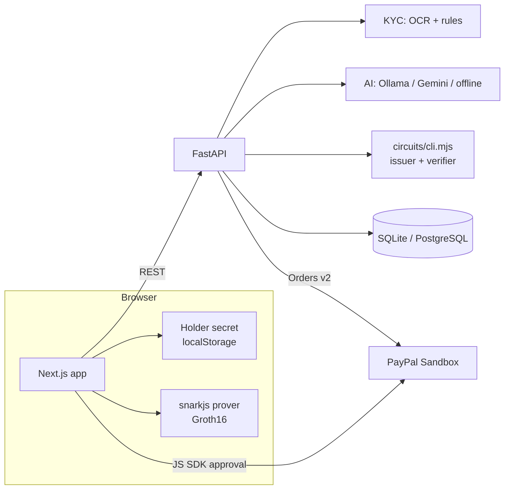

# ZK Pass

**Verify once. Prove anywhere. Pay faster.**

ZK Pass is a privacy-preserving identity verification and payment authorization
prototype built for the [PayPal AI Hackathon](https://paypalaihackathon.devpost.com/).

A user completes an AI-assisted KYC demo once and receives an issuer-signed credential
bound to a secret that only their browser holds. When a payment needs proof that they
passed KYC, the browser generates a real **Groth16 zero-knowledge proof** instead of
sharing documents. Only a valid, payment-bound proof unlocks **PayPal Sandbox** checkout,
and the backend captures and validates the order server-side.

> Independent hackathon prototype, not an official PayPal product.
> All identity data is mock/test data and all payments run in **PayPal Sandbox**. No real money moves.

## What it does

| Module | What happens |
|---|---|
| **ZK Verify AI** | An AI assistant guides a KYC session. Tesseract OCR reads a SPECIMEN test card, rule-based checks compare it with what the user typed, liveness is **simulated and labelled**, and the AI writes a neutral evidence summary. A **human reviewer** approves or rejects. |
| **ZK Passport** | The browser creates a holder secret and sends only `Poseidon(secret)`. The issuer signs the credential (EdDSA on BabyJubJub over a Poseidon hash) with the `kyc_approved` claim and an expiry date. |
| **ZK Pay** | For each payment request, the browser proves in-circuit: valid issuer signature, holder binding, `kyc_approved = 1`, not expired. It outputs a one-time **nullifier** bound to that payment and a verifier-scoped **revocation tag**. |

The backend rejects proofs that are **altered**, **bound to another payment**, **stale**,
from an **untrusted issuer**, **revoked**, or **replayed**. Checkout stays locked until a
proof passes. The payment page has a *Try to break it* panel that demonstrates each case.

### The privacy property

The verifier receives seven public values: the nullifier, revocation tag, issuer public key,
timestamp, payment challenge and verifier ID. It never sees the user's name, date of birth,
document number, credential ID or holder secret. Raw document images are processed in memory
and discarded; only masked fields and check outcomes are stored.

## Architecture



| Path | Contents |
|---|---|
| `circuits/` | Circom circuit `kyc_payment.circom`, Groth16 keys, signing/proving library, CLI bridge, tests |
| `backend/` | FastAPI app: auth, KYC, review, credentials, payment gate, PayPal, tests |
| `frontend/` | Next.js 16 app with in-browser proving |
| `samples/` | Fictional SPECIMEN test cards for the KYC demo |
| `docs/` | Product requirements and hackathon checklist |

## External APIs used

| API | Used for | Cost |
|---|---|---|
| PayPal REST API, Sandbox: OAuth2 + Orders v2 (create, capture, get) | Checkout after the proof gate | Free |
| PayPal JavaScript SDK (Sandbox client ID) | Buyer approval popup | Free |
| Ollama (local) **or** Google Gemini API free tier | KYC assistant, field extraction, explanations, reviewer summary | Free |

Everything else runs locally: Circom and snarkjs (ZK), Tesseract (OCR), SQLite (database).
With `LLM_PROVIDER=none`, the app runs fully offline apart from PayPal.

## AI tools & models

- **Ollama with `llama3.2:3b`** (default, runs locally) or **Google Gemini `gemini-2.0-flash`** (free tier), selected by `LLM_PROVIDER`.
- Used to guide the user step by step, extract structured fields from noisy OCR text, explain failed checks in plain language, and write a neutral evidence summary for the reviewer.
- Guardrails: the model never approves or rejects a session and never judges identity or liveness from a face, voice or tone. Approval is a human decision backed by deterministic checks. If no model is reachable, deterministic templates take over so the flow never breaks.

## Run it locally

### Prerequisites
- Node.js 20+ and npm
- Python 3.11+
- Tesseract OCR: `sudo apt install tesseract-ocr`, `brew install tesseract`, or the Windows installer from the UB Mannheim builds
- Optional: [Ollama](https://ollama.com) with `ollama pull llama3.2:3b`
- A free [PayPal Developer](https://developer.paypal.com) account for Sandbox credentials

### 1. ZK circuit tools
```bash
cd circuits
npm install
npm test            # 9 proof tests: valid, tampered, wrong payment, replay, expired, rogue issuer...
```
The proving and verification keys are committed in `circuits/keys/`. To regenerate them,
run `npm run setup`; it takes about 7 minutes and is a local, demo-only ceremony.

### 2. Backend
```bash
cd backend
python -m venv .venv && source .venv/bin/activate   # Windows: .venv\Scripts\activate
pip install -r requirements.txt
cp .env.example .env
python -m app.cli new-issuer-key        # paste the output into ISSUER_PRIVATE_KEY_HEX in .env
# add PAYPAL_CLIENT_ID and PAYPAL_CLIENT_SECRET from developer.paypal.com → Apps & Credentials → Sandbox
python -m app.cli seed                  # creates payer, merchant and reviewer demo accounts
uvicorn app.main:app --reload --port 8000
```
Run the tests with `python -m pytest -q tests` (29 tests; the PayPal tests mock the provider).

### 3. Frontend
```bash
cd frontend
npm install
cp .env.example .env.local
npm run dev                             # http://localhost:3000
```

### Demo accounts
After `python -m app.cli seed`, every account uses the password `zkpass-demo-123`:

| Email | Role |
|---|---|
| `payer@zkpass.dev` | Completes KYC, holds the Passport, pays |
| `merchant@zkpass.dev` | Creates the payment request |
| `reviewer@zkpass.dev` | Approves or rejects KYC sessions |

For checkout, log in to the PayPal popup with the **Sandbox personal (buyer) account** listed
under *Sandbox → Accounts* in the PayPal Developer dashboard.

## Walkthrough
1. Sign in as **payer**, open **Verify**, agree, keep the prefilled details, and upload
   `samples/specimen_pan_card.png`. Try `mismatch_name_card.png` to see checks fail.
2. Complete the simulated liveness step and submit.
3. In another browser profile, sign in as **reviewer**, open **Review queue** and approve.
4. As payer, open **Passport** and select **Issue Passport**.
5. As **merchant**, open **Pay** → **Create payment request** and copy the link.
6. As payer, open the link. Use **Try to break it** to watch each bad proof get rejected, then
   **Generate proof and unlock**, pay with the Sandbox buyer account, and see the receipt with the
   real PayPal order and capture IDs.

## Security notes and limits
- The Groth16 setup is a local, single-contributor ceremony suitable for a demo only.
- The issuer key lives in `.env`; production would use a KMS or HSM.
- Liveness is simulated. Production KYC (Aadhaar/PAN, V-CIP) needs authorized integrations and a regulated entity.
- PayPal Checkout is a buyer-to-merchant flow. This is not a cross-border payout product, and zero-knowledge proofs don't speed up settlement; they remove repeated identity disclosure.

See [`docs/PRD.md`](docs/PRD.md) for the full specification.

## License

[MIT](LICENSE)
